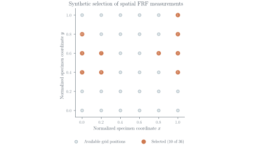
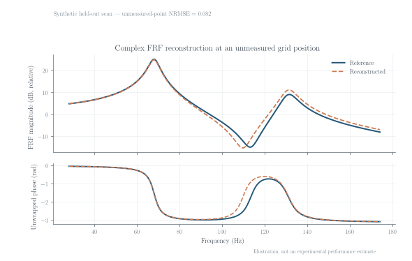

# SparseLDV-QA

**Sensor placement and complex frequency-response reconstruction for sparse vibrometry.**

SparseLDV-QA selects spatial measurement locations from training FRFs and reconstructs the complex response at unmeasured locations. The package exposes response-based selection, geometric and QR/POD baselines, graph-regularized reconstruction, and held-out error measures. It is intended for researchers working with scanning laser Doppler vibrometry and other spatially sampled FRF data.

**Research software preview · v0.8.2 · Python 3.10–3.13 · MIT**

## Example: select points, reconstruct responses



*Ten locations selected on a 36-point synthetic grid. Labels indicate selection order.*



*Synthetic reference and reconstructed FRFs at a withheld grid point. The reported NRMSE uses all withheld positions.*

Both figures use the package API and a fixed, reproducible synthetic example. Regenerate them with `python examples/make_readme_figures.py`.

## Install and run

Clone this repository and run the following commands from its root directory:

```bash
python -m pip install -e .
python examples/quickstart.py
```

The quickstart runs a known-truth synthetic reconstruction and prints the NRMSE. To run the test suite:

```bash
python -m pip install -e ".[dev]"
python -m pytest -q
```

## Import your FRFs

Supply either a CSV measurement table or an NPZ archive, with a JSON schema describing coordinate columns, frequencies, units and complex representation.

```bash
sparseldv-qa convert examples/step3_user_data/frf_long.csv \
  --schema examples/step3_user_data/schema.json \
  --output example_frfs.npz

sparseldv-qa example_frfs.npz --count 2 \
  --output example_reconstruction.npz
```

The converter checks the frequency grid and spatial sample identifiers before writing a normalized NPZ and a provenance manifest. Complex data may be stored as real/imaginary parts or as magnitude/phase with an explicit phase convention. See [Data import](docs/USER_DATA_IMPORT.md) for the input contract and the NumPy example.

## Method in brief

For observed FRFs $\mathbf{H}_{\mathrm{obs}}$ at selected spatial positions, reconstruction solves

$$
\left(\mathbf{D}+\alpha\mathbf{L}+\varepsilon\mathbf{I}\right)\widehat{\mathbf{H}}=\mathbf{B},
$$

where $\mathbf{L}$ is a graph Laplacian derived from spatial coordinates, $\mathbf{D}$ contains observation weights at the measured positions, and $\mathbf{B}$ contains the weighted measured complex FRFs. The regularization parameter $\alpha$ controls spatial smoothing. Sensor selection and parameter tuning must use training data only.

Evaluation reports complex-response NRMSE and median FRAC at withheld positions. For experimental comparisons, use reference FRFs from independent measurement groups.

## Inputs and outputs

- **Input:** complex FRFs, sensor coordinates, and optional coherence estimates.
- **Output:** selected locations, spatially reconstructed complex FRFs, NRMSE and FRAC summaries.
- **Evaluation:** performance depends on geometry, excitation, signal quality and the training/test split.

The repository includes generated example measurements. For experiments with grouped scans, see [`examples/benchmark_real_frf.py`](examples/benchmark_real_frf.py) and the [measurement notes](docs/RESEARCH_NOTES.md). [FAQ](docs/FAQ.md) covers common import questions.

## Reproduce the figures

```bash
python examples/make_readme_figures.py
# Optional: use an installed LaTeX distribution to typeset figure labels
python examples/make_readme_figures.py --latex
```

The two SVG files are stored in `docs/figures/`; their generation script is in `examples/`.

## Citation and license

Use [`CITATION.cff`](CITATION.cff) when citing the software and [`LICENSE`](LICENSE) for license terms. Refer to the original source when citing an experimental dataset.
